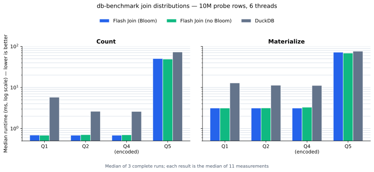

# Flash Join

Flash Join is a parallel `uint64` join engine for NumPy. Its general-purpose
fallback is the **unchained** join table described in
CedarDB's [Simple, Efficient, and Robust Hash Tables for Join Processing](https://cedardb.com/blog/simple_efficient_hash_tables/)
and its linked [DaMoN '24 paper](https://db.in.tum.de/~birler/papers/hashtable.pdf).
An adaptive dispatcher uses a direct-address perfect table for unique, dense
integer build domains and otherwise leaves the CedarDB implementation unchanged.

The project intentionally exposes a small engine rather than claiming to be a
general database replacement. `benchmarks/benchmark.py` compares the join core
with DuckDB using the same thread count and validates result cardinality before
reporting timings.

## CedarDB design correspondence

| CedarDB technique | Flash Join implementation |
| --- | --- |
| Power-of-two directory sized as `2^ceil(log2(1.125n))` | `UnchainedHashTable::directory_capacity` |
| High hash bits select a directory slot | Shift-only `slot_for` |
| Dense adjacency array for collisions and duplicates | Consecutive `BuildTuple` ranges |
| Neighboring entries delimit each range | Branch-free `directory[-1]` sentinel and packed end offsets |
| Per-slot 16-bit register-blocked Bloom filter | Compile-time `UseBloomFilter` policy; enabled entries use their low 16 bits |
| Four-bit tags from a 4 KiB, 2048-entry table | All 1820 four-of-sixteen tags plus deterministic uniform padding |
| CRC hash specialized for 64-bit keys | Two hardware CRC32C operations and the paper's `0x2545F4914F6CDD1D` multiply |
| Parallel, lock-free build via partition ownership | Build-side hash partitioning followed by per-partition count/prefix/copy |
| Dense writes during tuple collection | Small software write-combine buffers |
| Tight probe loop with CPU-managed memory-level parallelism | No explicit prefetch; Bloom-enabled non-matches stop at the fused check |

Unlike the previous implementation, duplicate build keys are never discarded:
the table has the multimap semantics required by relational joins.

The perfect-table specialization is attempted only when the build range spans
at most 1,048,576 and needs no more than four slots per build row. Duplicate
keys immediately fall back to the unchained table. This targets dense dimension
keys without increasing the resident memory of sparse joins.

## Repository layout

```text
flash_hash_join/
├── include/flash_join/        # Hashing, worker pool, perfect and unchained tables
├── src/                       # Python extension bindings and join operators
├── tests/                     # Correctness and Bloom-policy equivalence tests
├── benchmarks/                # Synthetic and H2O/DuckDB benchmarks
├── scripts/                   # Dataset generation utilities
├── CMakeLists.txt             # Native target
└── pyproject.toml             # Python build/package metadata
```

The historical benchmark charts in the repository root predate the unchained
implementation. New benchmark runs write raw measurements under `artifacts/`,
which is intentionally ignored by Git.

## Build and test

Python 3.9+, CMake 3.20+, and a C++17 compiler are required. Hardware CRC32C is
used on SSE4.2 x86-64 and CRC-capable AArch64; other targets use a portable
fallback.

```bash
python -m venv .venv
source .venv/bin/activate
python -m pip install -e '.[test,benchmark]'
pytest
```

The extension no longer requires mimalloc to build. The existing submodule is
kept for reproducibility of older revisions but is not part of the v0.2 target.

## Python API

```python
import numpy as np
import flash_join

build_keys = np.array([1, 1, 2], dtype=np.uint64)
build_values = np.array([10, 11, 20], dtype=np.uint64)
probe_keys = np.array([1, 2, 3], dtype=np.uint64)

flash_join.set_num_threads(8)

# Includes both rows for duplicate key 1.
count, core_seconds = flash_join.join_count(
    build_keys, build_values, probe_keys
)

# Materializes into per-worker chunks, matching a chunked database pipeline.
count, core_seconds = flash_join.join(
    build_keys, build_values, probe_keys
)

# Retrieve materialized columns when the rows themselves are needed.
joined_keys, joined_values, core_seconds = flash_join.join_pairs(
    build_keys, build_values, probe_keys
)

# Compile-time specialization with all Bloom work removed.
count, core_seconds = flash_join.join_count_no_bloom(
    build_keys, build_values, probe_keys
)
```

Dense-domain routing is automatic. The only
explicit variants are the default CedarDB Bloom layout and the `*_no_bloom`
experiment used when the unchained fallback is selected. Build-side
partitioning remains an internal parallel-build stage rather than a separate
join algorithm. Parallel phases reuse a persistent native worker pool.

## Benchmark

Run the deterministic synthetic comparison:

```bash
python benchmarks/benchmark.py \
  --threads 8 \
  --build-size 1000000 \
  --probe-size 10000000 \
  --match-rate 0.5 \
  --repeats 5
```

`--match-rate` controls join selectivity. The fused Bloom fast path is designed
for selective workloads, so benchmark both the expected production rate and a
high-match stress case rather than relying on one aggregate number. Every run
reports `flash_join_bloom`, `flash_join_no_bloom`, and `duckdb`.

Run the original db-benchmark join key distributions directly in memory:

```bash
python benchmarks/benchmark.py \
  --db-benchmark-size 10000000 \
  --threads 6 \
  --repeats 11
```

This is a NumPy port of `db-benchmark/_data/join-datagen.R`: it retains the 90%
common, 10% side-only domains and `sample_all` multiplicities, while generating
only the columns consumed by this uint64 join. `Q4-encoded` dictionary-encodes
the original `id5` string representation back to its `id2` equality domain; it
is deliberately not presented as a native string-join measurement.

Alternatively, if R and data.table are installed, generate and read the original
CSV files:

```bash
git submodule update --init db-benchmark
bash scripts/generate_data.sh
python benchmarks/benchmark.py --data-dir data --threads 8 --repeats 5
```

For both engines, ingestion happens before timing. The benchmark records the
median join time, checks identical row counts, and writes the raw CSV to
`artifacts/benchmark.csv`.

### Reference result

The following result was measured on an Apple M5 Pro with a Release build,
six worker threads, DuckDB 1.4.5, NumPy's db-benchmark port at size 10,000,000,
and seed 108. Each cell is the median of three complete benchmark runs; each
complete run itself reports the median of 11 measurements. Lower is better.



| Case | Task | Flash Join Bloom | Flash Join no Bloom | DuckDB | No-Bloom speedup |
| --- | --- | ---: | ---: | ---: | ---: |
| Q1 | count | 0.692 ms | **0.684 ms** | 5.787 ms | **8.46x** |
| Q1 | materialize | 3.156 ms | **3.136 ms** | 12.850 ms | **4.10x** |
| Q2 | count | **0.687 ms** | 0.710 ms | 2.626 ms | **3.70x** |
| Q2 | materialize | **3.144 ms** | 3.170 ms | 11.293 ms | **3.56x** |
| Q4-encoded | count | **0.686 ms** | 0.699 ms | 2.610 ms | **3.74x** |
| Q4-encoded | materialize | **3.139 ms** | 3.292 ms | 11.171 ms | **3.39x** |
| Q5 | count | 50.369 ms | **48.908 ms** | 73.112 ms | **1.49x** |
| Q5 | materialize | 71.964 ms | **68.855 ms** | 76.402 ms | **1.11x** |

The speedup column is `DuckDB / Flash Join no Bloom`. Q1, Q2, and Q4 use the
adaptive perfect-table path, so their Bloom and no-Bloom labels converge to the
same implementation; their small differences are measurement noise. Q5 uses
the CedarDB-style unchained fallback and shows the intended Bloom-policy
comparison. Materialization produces the same two `uint64` columns for both
engines; input ingestion remains excluded.

The source numbers are committed as
`benchmarks/results/db_benchmark_10m_m5_pro.csv`. Regenerate the SVG after
editing or replacing them with:

```bash
python benchmarks/plot_results.py
```

## License

[MIT](LICENSE)
